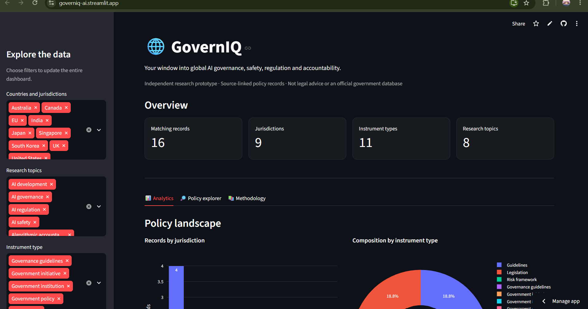

# GovernIQ — AI Governance Dashboard

An interactive dashboard for exploring global AI governance policies, safety frameworks, and regulations.

## Overview

GovernIQ is a Python-based dashboard designed to make AI governance information easier to explore and understand. It provides a structured interface for examining AI safety frameworks, governance policies, and regulatory information.

## Features

- **AI Governance Exploration:** Explore information about AI governance policies and safety frameworks.
- **Interactive Dashboard:** Navigate governance-related information through a user-friendly interface.
- **Organized Data:** Use structured data files to support governance information and exploration.
- **Testing:** Includes a test suite to help validate application functionality.

## Tech Stack

- **Language:** Python
- **Application:** Python web dashboard
- **Data:** Structured files in the `data/` directory
- **Testing:** pytest
- **Version Control:** Git and GitHub

## Project Structure

```text
GovernIQ/
├── data/              # Governance-related data
├── tests/             # Application tests
├── app.py             # Main application
├── requirements.txt   # Python dependencies
├── README.md          # Project documentation
└── .gitignore
```

## Getting Started

### Prerequisites

- Python 3.10 or later
- Git

### Installation

Clone the repository:

```bash
git clone https://github.com/kapilans2509/GovernIQ.git
cd GovernIQ
```

Install the dependencies:

```bash
pip install -r requirements.txt
```

### Run the Application

```bash
python app.py
```

If the application uses a web framework, follow the framework-specific startup instructions in `app.py`.

## Screenshots

Add screenshots of the actual application here to demonstrate the dashboard and its features.

```markdown

```

## Testing

Run the test suite with:

```bash
pytest
```

## Potential Applications

- Exploring AI governance policies and safety frameworks
- Understanding AI regulatory approaches
- Supporting AI governance research and education

## Future Improvements

- Add more governance frameworks and regulatory datasets.
- Introduce search and filtering across governance resources.
- Add comparative views for different governance frameworks.
- Improve data visualization and reporting.
- Expand automated test coverage.

## Contributing

Contributions, suggestions, and improvements are welcome. Fork the repository, create a feature branch, and submit a pull request.

## Disclaimer

This project is intended for educational and informational purposes. The accuracy and completeness of governance information depend on the underlying data sources.

## Author

**Kapilan**

GitHub: [@kapilans2509](https://github.com/kapilans2509)
